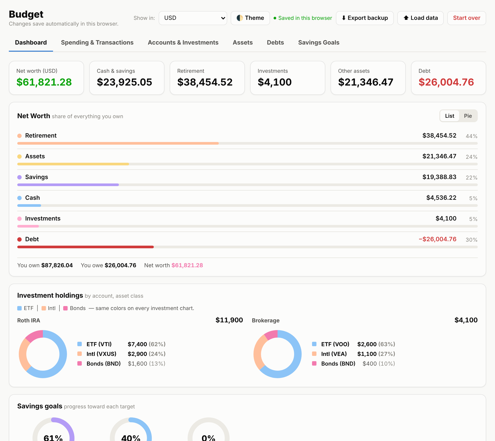
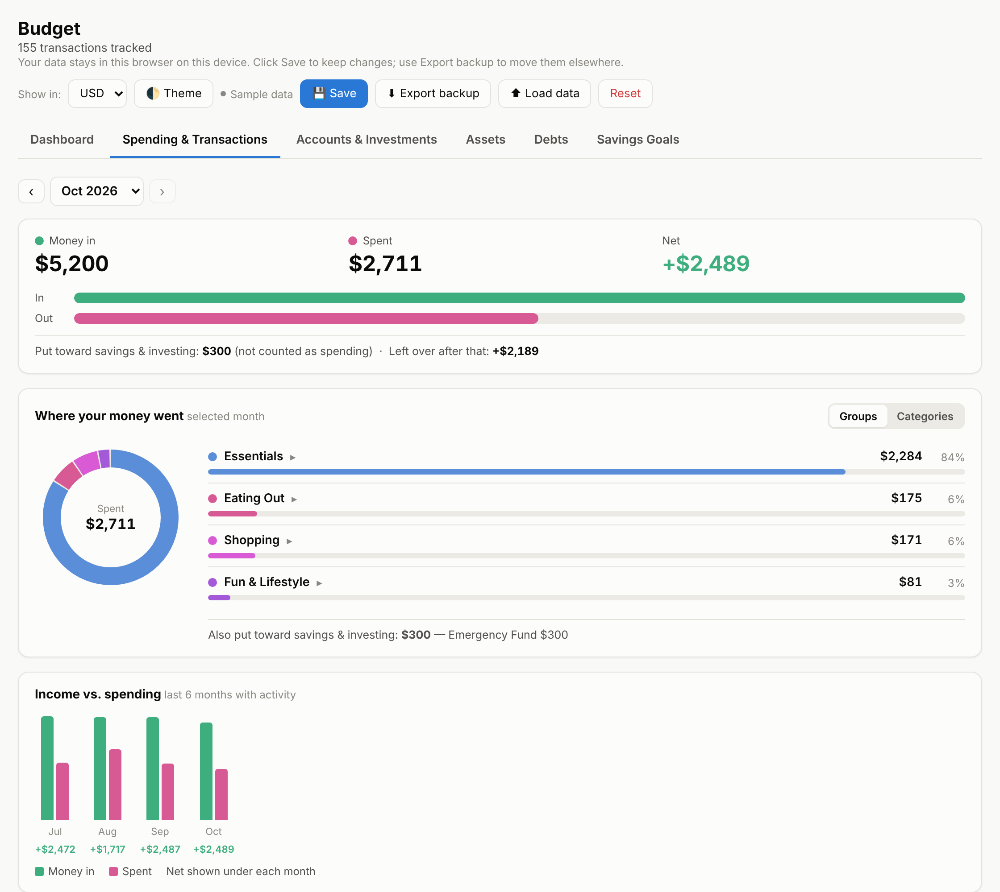

> ## ⚠️ Commercial Project / All Rights Reserved
>
> This repository is for portfolio and evaluation purposes by potential employers. You may view and review the source code. The only other permitted use is running the unmodified app for your own personal, non-commercial budgeting, as described in [Use it in Claude](#use-it-in-claude). You do not have permission to modify, distribute, resell, share publicly, or use this code in any other personal or commercial project.
>
> © 2026 Alex Martin. All rights reserved.

# Budget Template

A personal finance dashboard that runs entirely in your browser: spending, budgets, net worth, investments, debt payoff and savings goals in one page. No account, no server, no tracking. Your data never leaves your device.

**[▶ Open the live demo](https://tayloramartin220.github.io/budget-app/)** (loads with sample data)



## Features

- **Dashboard**: net worth at a glance, broken down into cash, savings, retirement, investments, other assets and debt
- **Spending & transactions**: monthly money in vs. out, spending by group and category, a six-month trend, and budget targets per category
- **Bank import**: drop in an Excel (.xlsx) or CSV export from your bank, then review categories before anything is added. Payees you've categorized before are filled in automatically
- **Accounts & investments**: holdings by asset class, with target allocations to show when you're off balance
- **Debts**: payoff timeline with and without extra payments, plus interest saved
- **Savings goals**: progress and pacing toward each target date
- **Multi-currency**: USD, EUR and ISK accounts side by side, shown in the currency of your choice
- **Light & dark themes**



## How your data is stored

Everything is saved in your browser's local storage on the device you're using. Nothing is uploaded.

- **Save** keeps your changes in this browser.
- **Export backup** downloads your data as a JSON file. Use it to back up or move to another device, then load it there with **Load data**.
- **Reset** clears everything, including the sample data, so you can start fresh with the default categories.

Clearing your browser's site data will erase saved data, so export a backup now and then.

## Use it in Claude

If you use [Claude](https://claude.ai), you can publish the app as your own private artifact and keep it in your artifacts list:

1. Download [`index.html`](index.html). Open the file on GitHub and click the **Download raw file** button.
2. Start a new chat in Claude and attach the file.
3. Send this message:

   ```
   Publish this HTML file as an artifact exactly as it is, without changing any code.
   ```

Your artifact is private to you until you choose to share it. Data you enter is saved in your browser, the same way it works on the live demo. Click **Reset** to clear the sample data and start with your own.

This permission covers personal use of the unmodified app only. Please don't share your artifact link publicly, modify the app, or redistribute it.

## Run it locally

It's a single HTML file. Download `index.html` and open it in any modern browser.

## License

No license is granted. © 2026 Alex Martin. All rights reserved. You're welcome to try the live demo, review the code, and run the unmodified app for your own personal budgeting, either locally or as a private Claude artifact. Modifying, distributing, reselling or using it in any other project requires written permission. For inquiries, contact me through my GitHub profile.
