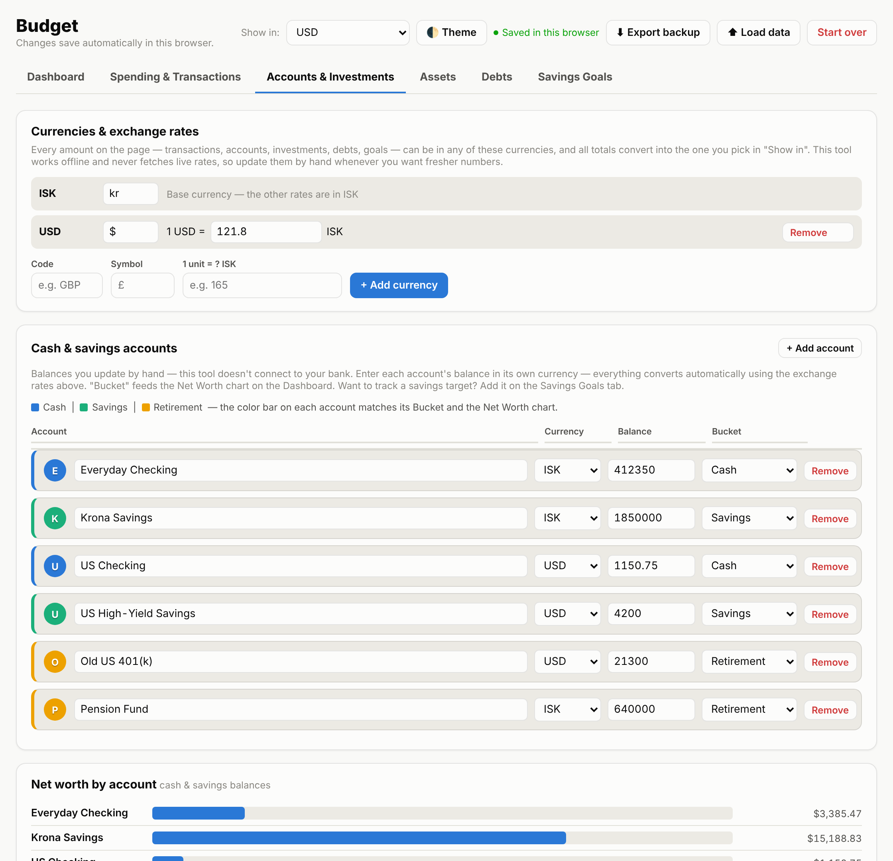
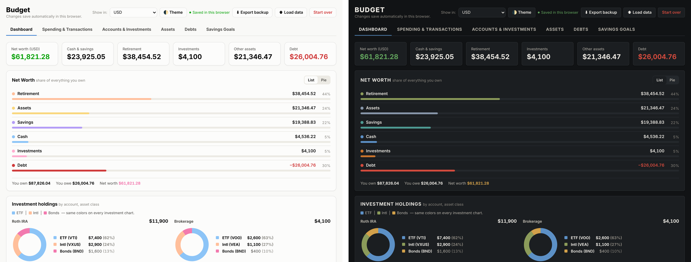

> ## ⚠️ Commercial Project / All Rights Reserved
>
> You may view and review the source code in this repository, and run the unmodified app for your own personal, non-commercial budgeting. You do not have permission to modify, distribute, resell, share publicly, or use this code in any other personal or commercial project.
>
> © 2026 Alex Martin. All rights reserved.

# Budget App

A private, browser-based personal finance dashboard. Track spending and budgets, import bank exports, and see net worth, investments, debt payoff and savings goals in one place. No account, no server, no tracking. Your data never leaves your device.

**[▶ Try the live demo](https://tayloramartin220.github.io/budget-app/)** (loads with sample data in US dollars and Icelandic krónur)

## Features

- **Dashboard**: net worth at a glance across cash, savings, retirement, investments, other assets and debt, plus progress rings for savings goals and debt payoff
- **Spending & transactions**: money in vs. out each month, spending by group and category, a six-month trend, and itemized entries
- **Bank import**: drop in an Excel (.xlsx) or CSV export from your bank and review categories before anything is added. Payees you've categorized before fill in automatically
- **Transfers**: move money between your own accounts without it counting as spending
- **Accounts & investments**: account balances, holdings by asset class, and target allocations that show when you're off balance
- **Debts**: payoff timeline with and without extra payments, and the interest you'd save
- **Savings goals**: progress and pacing toward each target date
- **Multi-currency**: every amount can be in its own currency, and all totals convert into the one you choose. Add any currency and set your own exchange rates. Handy if you travel, live abroad or hold accounts in more than one country
- **Light & dark themes**: switch any time with the Theme button
- **No account or server**: it's a single file that runs in your browser

## Themes

Light on the left, dark on the right. The app follows your device's setting by default.

## How your data is stored

Everything saves automatically in your browser's local storage on the device you're using. Nothing is uploaded.

- **Export backup** downloads your data as a file. Use it to back up or move to another device, then open it there with **Load data**.
- **Start over** clears everything so you can begin with a blank budget, or reloads the sample data.

Clearing your browser's site data erases saved data, so export a backup now and then.

## Run it locally

It's a single HTML file. Download `index.html` and open it in any modern browser. It opens with sample data so you can explore, then use **Start over** to begin with your own.

## License

No license is granted. © 2026 Alex Martin. All rights reserved. You're welcome to try the live demo, review the code and run the unmodified app for your own personal budgeting. Modifying, distributing, reselling or using it in any other project requires written permission. For inquiries, contact me through my GitHub profile.
